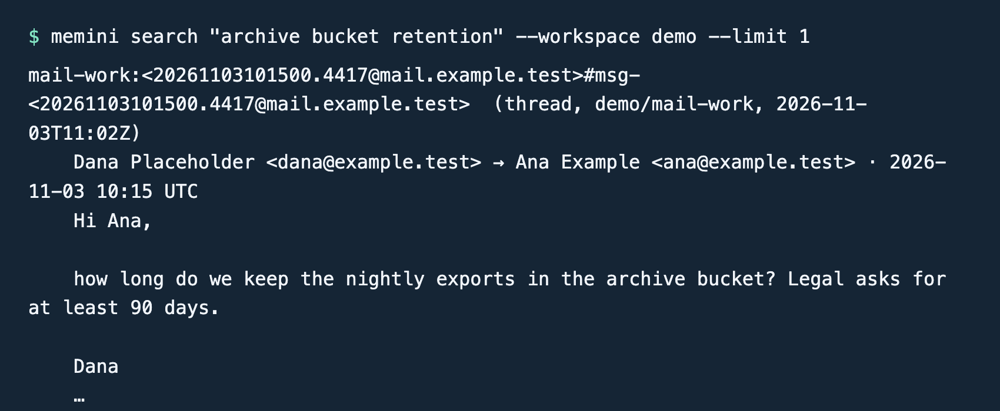

# Your first search

Import an invented two-message email conversation. By the end, a search for archive retention will point to the original thread. You can do this from a terminal without connecting a mailbox or an agent.

## Before you start

Complete the [installation through step 5](install.md#5-the-first-admin-token). Use the same terminal as the installation guide, with its `memini` shortcut, packaged resources path and admin token file selected. On a new terminal, repeat [the shell setup](install.md#4-the-memini-command) and point `MEMINI_TOKEN_FILE` to your saved admin token. For the manual ZIP, run from the release folder with its CLI shortcut on PATH and `MEMINI_RESOURCES="$PWD"`. A **workspace** groups related sources. A **source** identifies where a record came from. Here the workspace is `demo` and the source is a mailbox named `mail-work`.

## Create the mailbox source

```sh
memini workspace create demo
memini source add demo mail-work --kind push
```

If you already created `demo` during installation, skip the first command. Check an existing mailbox source with `memini source show demo mail-work`. Reuse the ingest token file on later runs. The admin token stays selected for the final search.

## Import the conversation

Open the [sample email](examples/mail-thread.json). The subject is in `payload.title`; both messages carry their original Message-ID, author, recipients, text and timestamp. The thread's stable `external_id` makes repeat imports safe.

Create a workspace-scoped ingest token once. Reuse the same file for repeat imports.

**Bash or Zsh**

```sh
mail_token="$HOME/.config/memini/demo-mail.token"
( set -C; umask 077; memini token create --scope ingest --workspace demo --name demo-mail > "$mail_token" )
sample="$MEMINI_RESOURCES/docs/examples/mail-thread.json"
MEMINI_TOKEN_FILE="$mail_token" memini push --workspace demo --source mail-work --stream inbox --dry-run - < "$sample"
MEMINI_TOKEN_FILE="$mail_token" memini push --workspace demo --source mail-work --stream inbox - < "$sample"
```

**PowerShell**

In a new PowerShell window, copy the `Save-MeminiToken` function definition from [the token setup](install.md#5-the-first-admin-token).
The pipeline reads the sample as UTF-8. The final block restores the admin token for the search.

```powershell
$mailToken = Join-Path $HOME '.config/memini/demo-mail.token'
Save-MeminiToken $mailToken { memini-server cli token create --scope ingest --workspace demo --name demo-mail }
$sample = Join-Path $MeminiResources 'docs/examples/mail-thread.json'
$previousToken = $env:MEMINI_TOKEN_FILE
$previousEncoding = $OutputEncoding
try {
    $env:MEMINI_TOKEN_FILE = $mailToken
    $OutputEncoding = [Text.UTF8Encoding]::new($false)
    Get-Content -Raw -Encoding UTF8 $sample | memini-server cli push --workspace demo --source mail-work --stream inbox --dry-run -
    if ($LASTEXITCODE -ne 0) { throw 'The sample failed validation.' }
    Get-Content -Raw -Encoding UTF8 $sample | memini-server cli push --workspace demo --source mail-work --stream inbox -
    if ($LASTEXITCODE -ne 0) { throw 'The sample import failed.' }
} finally {
    $env:MEMINI_TOKEN_FILE = $previousToken
    $OutputEncoding = $previousEncoding
}
```

The dry run validates one record. The first push reports one inserted record. Sending the same file again reports one unchanged record. If a row is rejected, the summary names the field to fix. An authentication error usually means the token lacks `ingest` or belongs to another workspace.

## Find the answer

```sh
memini search "archive bucket retention" --workspaces demo --limit 3
```



Find the hit from `mail-work`. Dana asked for at least 90 days. Ana replied that the bucket kept exports for 30 days and she planned to increase it to 120. The thread shows a proposal; a [later meeting example](examples/meeting.json) records what actually changed.

If the push stored the message but search says `embeddings_not_configured`, configure Ollama and reindex `demo` as described in [troubleshooting](install.md#troubleshooting). To import your own mailbox, use the [Intake guide](intake.md).
