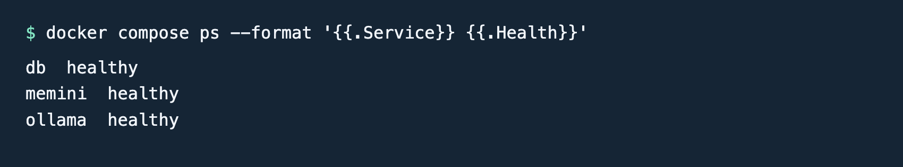

# Install Memini

Choose where Memini will run. If this is your first installation and you’re working on your own computer, start with **Run a local server**.

<nav class="install-paths" aria-label="Installation options">
<a href="#what-you-need"><strong>Run a local server</strong><span>Start Memini, its database and its search model with Docker.</span></a>
<a href="install-cli.md"><strong>Connect to a server</strong><span>Install the CLI and sign in with the token your team gave you.</span></a>
</nav>

## What you need

- **macOS or Windows:** start [Docker Desktop](https://docs.docker.com/desktop/). On Windows, run these commands in a [WSL 2 terminal with Docker integration enabled](https://docs.docker.com/desktop/features/wsl/).
- **Linux:** install [Docker Engine and the Compose plugin](https://docs.docker.com/engine/install/).
- **Hardware:** 4 CPU cores, 8 GB RAM and 20 GB free SSD space. A GPU is optional. The first run downloads the application and its local search model.

Open your terminal and run `docker compose version`. Look for version **2.24 or newer**. Docker runs Memini, PostgreSQL and Ollama together. The steps use a Bash-compatible shell and OpenSSL for generating a password.

<a id="install-a-published-image-with-docker-only"></a>

## 1. Download the release

[Download the server setup files (.zip)](https://github.com/npavlov/memini/releases/download/v0.1.0-rc.1/memini-v0.1.0-rc.1-server.zip). Extract the ZIP, then open a terminal in the extracted folder containing `compose.yaml`. Keep this folder for future starts. It provides the Docker settings, the CLI shortcut and sample data. Docker downloads the prebuilt application.

## 2. Set the database password

Run this once in the extracted folder. It creates a private settings file for this installation. If you already have a `.env`, keep your password and update the two release settings in that file.

```sh
( set -C; umask 077
  password=$(openssl rand -hex 16) && printf '%s\n' \
    'COMPOSE_FILE=compose.yaml:compose.release.yaml' \
    'MEMINI_RELEASE_IMAGE=ghcr.io/npavlov/memini:0.1.0-rc.1' \
    "MEMINI_DB_PASSWORD=$password" > .env )
```

## 3. Start the server

```sh
docker compose up -d --wait ollama
docker compose exec -T ollama ollama pull qwen3-embedding:0.6b
docker compose up -d --no-build --wait
docker compose ps --format '{{.Service}}  {{.Health}}'
```

Wait for `db`, `memini` and `ollama` to show `healthy`. Memini listens on this computer at `http://127.0.0.1:6364`.



## 4. The `memini` command

```sh
chmod +x bin/memini
export PATH="$PWD/bin:$PATH"
memini --version
```

The shortcut runs the CLI inside Docker. Repeat the `export` from this folder when you open a new terminal.

## 5. The first admin token

```sh
mkdir -p ~/.config/memini
( set -C; umask 077; memini bootstrap > ~/.config/memini/admin.token )
export MEMINI_TOKEN_FILE=~/.config/memini/admin.token
memini workspace list
```

On a fresh installation the list is empty. Your token is saved in the private file. **Next, [import a sample email and run your first search](first-search.md)**, or follow the code example below.

## Connect to an existing server

Ask the operator for the server URL and a read token file. The [client installation guide](install-cli.md) covers the Windows x64 installer and Homebrew for Apple Silicon macOS and x86_64 Linux, with PowerShell and Bash examples. Run `memini workspace list` to check your connection. To develop Memini itself, use [Build from source](build-from-source.md).

## 6. A workspace and a repository

A workspace holds sources; a token can be limited to one. Create one, then add a repository by its
https URL, the tracked branch and how often to sync it. Any public repository works; this one is
Memini itself, limited to its bootstrap CLI file so the first sync is small on CPU-only machines:

```sh
memini workspace create demo
memini source add demo memini --location https://github.com/npavlov/memini.git --ref refs/tags/v0.1.0-rc.1 \
  --include 'src/memini/cli/admin.py' --schedule 1h
memini sync demo memini --wait --wait-timeout 45m
```

The service clones the repository into its own mirror, chunks the files and embeds them with
Ollama. `sync --wait` ends with `run … succeeded` for the selected ref; a
larger repository takes longer. Leave out `--include` to index every file. `sync --wait` waits 10
minutes by default (the quickstart allows 45); a sync that takes longer goes on in the service: wait longer with
`--wait-timeout 1h`, or follow it with `memini streams demo memini`. Then search it:

```sh
memini search "how is the first admin token created" --limit 3
```

The first hits are in `src/memini/cli/admin.py`, each with its locator
(`memini@<commit>:src/memini/cli/admin.py#L…`) and the first lines of the chunk.

### Your own repositories

A repository on this machine is a source once the service can see it: mount the directory that
holds your repositories into the container, read-only, and allow that path. Say your repositories
are under `~/src`; `compose.override.yaml` (ignored by git) adds the mount to `compose.yaml`:

```sh
cat > compose.override.yaml <<'EOF'
services:
  memini:
    volumes:
      - ${HOME}/src:/srv/repos:ro
EOF
echo 'COMPOSE_FILE=compose.yaml:compose.release.yaml:compose.override.yaml' >> .env
echo 'MEMINI_GIT_LOCAL_ROOTS=/srv/repos' >> .env.memini
docker compose up -d --wait
memini source add demo myapp --location /srv/repos/myapp --ref main
memini sync demo myapp --wait
```

`/srv/repos/myapp` is `~/src/myapp` as the container sees it. On Linux the files must be readable by
the service's user, uid 10001 (they are, with the usual modes 644 and 755). A private remote
repository needs a token or an ssh key: [configuration.md](configuration.md), "Git connector" and
"Secrets and other files".

## 7. Push a chat thread

Messages, mail and meeting notes come in through the push API: a push source takes the records
that a client or an agent sends it. Add one, and make a token that may only push into this
workspace (scope `ingest`), kept in a file only you can read. Then push the example thread with it:

```sh
memini source add demo chat --kind push
(umask 077; memini token create --scope ingest --workspace demo --name push > ~/.config/memini/ingest.token)
MEMINI_TOKEN_FILE=~/.config/memini/ingest.token memini push --workspace demo --source chat - < docs/examples/thread.json
```

`memini push` reads the records from stdin (`-`): `bin/memini` runs the command inside the
service's container, which cannot read a path on the host. It prints:

```
sent 1 record in 1 batch to demo/chat (stream chat/platform)
stored 1 (inserted 1, updated 0, revived 0), deleted 0, unchanged 0
```

[`docs/examples/thread.json`](examples/thread.json) is one batch with one invented thread. Pushing
it again changes nothing (`unchanged 1`). Without an embedding provider a third line says the
thread was stored but not indexed (see Troubleshooting). The shapes of chat and mail threads,
meetings and documents, with an example of each, and the rules for an agent that pushes what it
reads: [intake.md](intake.md).

The same batch with curl instead, which reads the header with the token from a file, so the token
is on no command line:

```sh
(umask 077; printf 'Authorization: Bearer %s\n' "$(cat ~/.config/memini/ingest.token)" > ~/.config/memini/ingest.header)
curl -sS -X POST -H @"$HOME/.config/memini/ingest.header" -H 'Content-Type: application/json' \
  --data-binary @docs/examples/thread.json \
  http://127.0.0.1:6364/v1/workspaces/demo/sources/chat/records
```

Its answer counts the thread (`"unchanged":1` after the push above), and
`"index":{"indexed":true,…}` says its chunks are embedded. Search everything:

```sh
memini search "when does the nightly export run" --limit 3
```

The first hit is the thread, `chat:platform/1793610720.000100#msg-…`, with its link and messages.

## 8. Connect Claude Code

Agents get a token with the `read` scope only. Make one, and add Memini to Claude Code for all your
projects:

```sh
(umask 077; memini token create --scope read --name claude-code > ~/.config/memini/read.token)
claude mcp add --scope user --transport http memini http://127.0.0.1:6364/mcp \
  --header "Authorization: Bearer $(cat ~/.config/memini/read.token)"
claude mcp list
```

`claude mcp list` shows `memini: http://127.0.0.1:6364/mcp (HTTP) - ✔ Connected`. Claude Code keeps
the token in its own configuration file. Start Claude Code and ask, for example: *What did the
platform channel decide about the nightly export? Use the memini search tool.* It calls `search` and
answers from the thread: 04:30 UTC, a 45-minute timeout.

Another MCP client takes the same URL and header, e.g. in its JSON configuration:

```json
{"mcpServers": {"memini": {"type": "http", "url": "http://127.0.0.1:6364/mcp",
                           "headers": {"Authorization": "Bearer <token>"}}}}
```

See [MCP client setup and tool reference](mcp/README.md) for Codex setup and a callable example for each tool.

## 9. Status

```sh
memini status
```

The first lines say whether the base is current, the database's schema version and the index: `ok`,
built with `qwen3-embedding:0.6b`. Below, one line per stream: the repository's branch and the
chat channel, with the last result, the lag and whether each is current. `memini status --gate`
exits 0 when everything is current and 6 when not, for scripts and health checks.

## Day to day

Run `docker compose stop` in the release folder to stop Memini and keep your data. To restart, run `docker compose up -d --no-build --wait`. Before upgrading, [back up the database](operations/backup.md).

## Machine size

See [machine requirements and measured performance](operations/performance.md#the-smallest-supported-machine).

## Troubleshooting

| What you see | What to check |
|---|---|
| Docker cannot connect | Start Docker and run `docker info`. On Windows, check WSL integration. |
| Port already allocated | Set `MEMINI_HTTP_PORT` or `MEMINI_DB_PORT` to a free port in `.env`, then repeat step 3. |
| Model download interrupted | Repeat the `ollama pull` command in step 3 and wait for it to finish. |
| Service unhealthy | Run `docker compose logs --tail 50 memini db ollama`. |
| No token in a new terminal | Repeat the two `export` commands from steps 4 and 5. |
| Search reports `embeddings_not_configured` | Check both release settings in `.env`, repeat step 3, then run `memini reindex --workspace demo` for data imported earlier. |

For token recovery, private repositories and agent setup, see the [operations runbook](operations/runbook.md) and [configuration reference](configuration.md).
